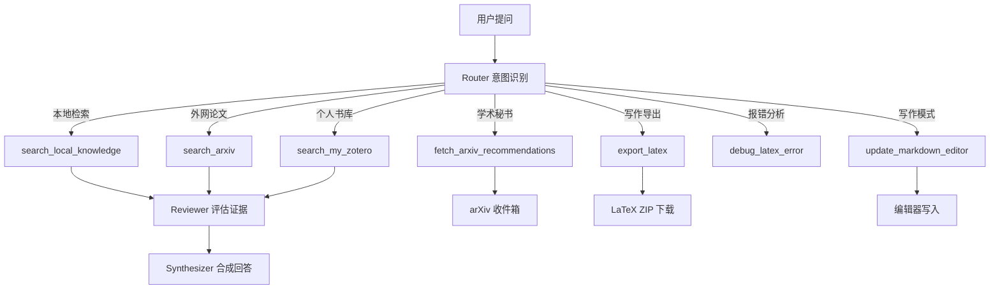

# Multi-Agent 架构说明（Router → Seeker → Reviewer → Synthesizer）

> 本文说明学术问答系统的多智能体链路：意图识别怎么做、Seeker 检索哪些资料、Reviewer 怎么评估、Synthesizer 怎么合成、为什么用 multi、如何优化。
> 代码位置：`aether_engine/api/chat.py`（编排）+ `aether_engine/api/search.py`（检索管线）。

## 0.1 全景流程图（单次请求）

```
HTTP POST /api/chat
  │
  ▼
load_state(session_id)                     # 工作记忆加载（ConversationState）
  │
  ▼
_is_followup(question, last_question)      # 追问判断（regex + 短问）
  ├─ 是 ──► 复用 evidence_cache（跳过检索）
  │
  └─ 否
      ▼
    ┌──────────────────────── Router ────────────────────────┐
    │ _route_with_tools（function-calling，max_rounds=2）    │
    │   ├─ search_local_knowledge ──► Seeker 检索管线        │
    │   │     ├─ 文档向量(1.8) + 文档BM25(1.0)               │
    │   │     ├─ 笔记向量(0.9) + 笔记BM25(0.7)               │
    │   │     ├─ 图谱 1/2-hop + 截图OCR(0.5)                 │
    │   │     ├─ 纯 RRF 融合（1/(60+rank)）                  │
    │   │     ├─ 重排（cross_encoder / llm / none）          │
    │   │     └─ top_k=10 候选                               │
    │   ├─ search_arxiv ──► _parse_arxiv_response（arxiv.py）│
    │   ├─ search_my_zotero / export_latex / debug_latex     │
    │   └─ baseline merge：去重 → 排序 → 截断 out_cap=16     │
    └────────────────────────────────────────────────────────┘
      ▼
Reviewer（_reviewer_heuristic，证据评分，启发式）
      ▼
Synthesizer（_build_synthesis_prompt：4轮历史+旧轮摘要+证据分区XML）
  → _call_chat_llm / _stream_chat_llm（provider-aware，core/llm.py）
      ▼
_finalize（更新 ConversationState：last_question / turn / concluded）
      ▼
返回 JSON（chat）或 SSE 流（chat_stream：step/delta/action/done）
```

## 0. 为什么用 Multi-Agent

把一次问答拆成四个职责分离的环节，收益有三：

1. **关注点分离**：路由（意图）≠ 检索（多通道召回）≠ 评估（证据质量）≠ 合成（答案）；
2. **可观测/可复现**：`_build_agent_traces` 记录 Router/Seeker/Reviewer/Synthesizer 每步，评测可回放；
3. **可消融**：`agent_mode` 开关（`full`/`no_router`/`no_arxiv`/`no_merge`/`retrieval_only`）能量化各环节贡献（评测里 multi-agent +13.2pt 就是这么来的）。

## 1. Router —— 意图识别 + 工具路由

**意图分类（四类）**：

| 意图 | 触发函数/工具 |
|---|---|
| 学术检索（细节） | `_is_research_detail_question`（文献/论文/doi/RRF/BM25/RAG 词） |
| 学术检索（事实） | `_is_factual_question` |
| **写作** | `_is_editor_action_intent`（帮我写/续写/润色/起草/write/draft）+ `export_latex`/`debug_latex_error` |
| **论文推荐 / 审稿** | `fetch_arxiv_recommendations` 工具 / `peer_review` 模式 |

**两层判断**：

### 1.1 正则启发式（快速、免费、确定性）

| 函数 | 判断 | 用途 |
|---|---|---|
| `_is_research_detail_question(q)` | 含「文献/论文/doi/实验/RRF/BM25/RAG…」等词 | 判定「必须走本地 RAG 并给引用」的细节型问题 |
| `_is_factual_question(q)` | 事实型问题 | 路由未选工具时强制本地检索 |
| `_is_editor_action_intent(q)` | 写作/编辑器动作（帮我写/续写/润色/起草…） | 触发写作工具 |

### 1.2 LLM function-calling（语义、动态）

Router 用 LLM + 工具 schema 动态决定调用哪个工具。当前**硬编码 7 个工具**：

| 工具 | 作用 | 关键参数 |
|---|---|---|
| `search_local_knowledge` | 本地知识库（向量+BM25+Graph 1/2-hop） | keywords |
| `search_arxiv` | 外网 arXiv 摘要 | keywords |
| `search_my_zotero` | 用户 Zotero 书库 | keywords, fetch_recent |
| `fetch_arxiv_recommendations` | 学术秘书：拉取最新论文写入收件箱 | keyword, research_goal |
| `export_latex` | Markdown → IEEEtran LaTeX（main.tex + .bib） | markdown |
| `debug_latex_error` | 分析 pdflatex/Overleaf 报错 | error_log, latex_snippet |
| `update_markdown_editor` | 写作工具：把结果写入编辑器（append/replace/insert） | 写作模式强制调用 |



> **关键约束**：事实型/文献细节型问题，即使 Router 没选工具，也会被 `_should_force_local_when_router_skips_tools` 强制走本地检索（防止漏检索）。

## 2. Seeker —— 多通道检索（资料从哪来）

`search_local_knowledge` → `_search_pipeline`，**单轮多路召回 + RRF 融合 + 可选重排**：

| 通道 | 内容 | 权重 |
|---|---|---|
| `doc_vector` | 文档分块稠密向量 | 1.8（最高） |
| `doc_bm25` | 文档分块 BM25 词法 | 可调（`RAG_BM25_WEIGHT`，默认 1.0） |
| `note_vector` | 原子笔记向量 | 0.9 |
| `note_bm25` | 原子笔记 BM25 | 0.7 |
| `graph_1hop` / `graph_2hop` | 知识图谱 1/2 跳扩展 | — |
| `graph_dochop` | 文档↔笔记跨类型扩展 | — |
| `screenshot_ocr` | 截图 OCR 文本 | 0.5 |

**资料种类**：文档原文分块（MinerU 解析）、原子笔记（UGC 蒸馏）、图谱三元组（tag 重叠边）、截图 OCR、arXiv 摘要、Zotero 摘要。

> ⚠️ **关键修复记录**：融合曾用 `0.65*rrf_score + 0.35*original_score`，把「排名分」和「不可比的原始分」（BM25 归一化到 1.0 vs 向量 cosine 0.3~0.9）混在一起，导致 BM25 不公平地挤掉向量。已改为**纯 RRF**（`merged_score = rrf_score`），只比排名。

## 3. Reviewer —— 证据评估

当前实现是**启发式**（`_reviewer_heuristic`，非 LLM）：

```python
avg = 检索分数平均值
grade = clamp(avg * 10, 4, 10)   # 0~10 分
status = "success" if grade >= 6.5 else "warning"
```

> ⚠️ **局限**：只看「检索分数」的统计，不真正判断「证据是否支撑答案」。这是优化点 1。

## 4. Synthesizer —— 答案合成

1. 把证据按**分区 XML** 组织（文献分区 / 笔记分区 / 图谱分区），每块带 `[n]` 角标；
2. LLM 依据分区证据合成最终回答，要求**带角标引用**；
3. 无证据时走 `_general_fallback_answer`（通用学术回答 + 诚实说明「本地库暂无该细节」）。

## 5. 如何优化（按优先级）

| # | 现状问题 | 优化方向 |
|---|---|---|
| 1 | Reviewer 是启发式（只看分数） | 改成 **LLM 评估**：判断「证据是否真正支撑回答的关键事实」，与评测裁判同构 |
| 2 | Seeker 是单轮多路 | 引入**多跳迭代检索**：retrieve → read → 生成子查询 → 再检索（解决 comp 型跨文档对比题） |
| 3 | 意图识别 = regex + 单次 function-calling | **查询分解**：把「对比 A 与 B」拆成两个子查询分别检索 |
| 4 | 合成无强制引用一致性 | **结构化输出**：强制角标 [n] 与证据一一对应，杜绝无中生有的引用 |
| 5 | 工具硬编码 | **技能注册表**（见 `AGENT_ARCH_PLAN.md` Phase 2） |
| 6 | 上下文无 token 预算 | 窗口管理（见 `AGENT_ARCH_PLAN.md` Phase 1） |

## 5.5 会话与登录

当前**无真正用户登录**，两层轻隔离：

| 机制 | 说明 |
|---|---|
| `X-Session-ID` header | 会话隔离（`core/session.py::get_session_id`），缺省 `"default"` |
| `.env` 的 `ENABLE_AUTH` + `AUTH_PASSWORD` | 简单密码认证，默认 `ENABLE_AUTH=false` |

> 要真正登录：加用户表 + JWT/session token + 用户→会话映射。

## 5.6 记忆层次（多 agent vs 多轮 vs 长期）

| 类型 | 内容 | 生命周期 | 现状 |
|---|---|---|---|
| **多 agent 状态**（单轮内） | Router 意图、Seeker 证据、Reviewer 评分、Synthesizer 答案 | 单次请求 | ❌ 不持久 |
| **多轮记忆**（跨轮） | 对话历史 + 任务状态（`ConversationState`） | 当前会话 | ✅ 已接入：history 拼 prompt（最近 8 轮）+ `ConversationState` 落盘（3a）+ 追问复用证据（3b-i） |
| **长期记忆** | 原子笔记 + 图谱（`data/notes.json` + `knowledge_graph`） | 跨会话 | ✅ 已有，但缺「按需检索 + 主动装卸」分层 |

**区别**：多 agent 是「角色分工」（空间维度），多轮是「时间累积」，记忆是「跨时间+跨角色的状态」。三者正交，汇聚点 = `ConversationState`（工作记忆）+ 笔记图谱（长期记忆）。

## 6. 与评测的对应关系

- 评测里 `--agent-mode full/retrieval_only` 消融的正是「Router + arXiv + merge」这三环对最终答案的贡献；
- 检索层（Seeker）的「向量+BM25 混合、重排、图谱」在 `--retrieval-mode` 里单独消融；
- **两层正交**：Seeker 的检索质量（hit@k）+ multi-agent 的编排质量（+13.2pt）各自可归因。
